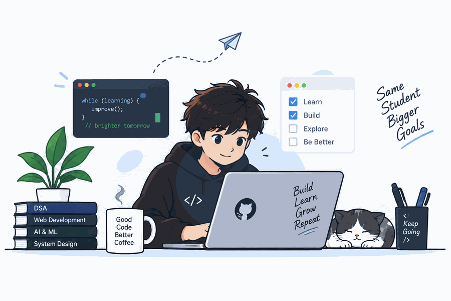

# Hi, I'm Abhishek Kumar 👋

Computer Science student and AI/ML intern from Noida, India. 
I build AI-powered apps and full-stack web applications.

  

### About Me

I'm passionate about software development, artificial intelligence,
and emerging technologies. I enjoy learning by building projects
and solving real-world problems.

## What I work with
- Languages: Python, JavaScript, c++
- Web: React, Node.js, Express, MongoDB
- AI: LLM apps, document Q&A (RAG), chatbots

  ## Featured projects
   - [DocuMind](https://github.com/Abhi5hekkumar/documind): upload a PDF and ask questions about it
   - [AI Student College Helpdesk](https://github.com/Abhi5hekkumar/AI-powered-student-college-helpdesk): chatbot for college queries

  
## Contact
- 📧 Email: [kumarabhishek8749@gmail.com](mailto:kumarabhishek8749@gmail.com)
- 💼 LinkedIn: [Abhishek Kumar](https://www.linkedin.com/in/abhishek-kumar-94888b276)

     
